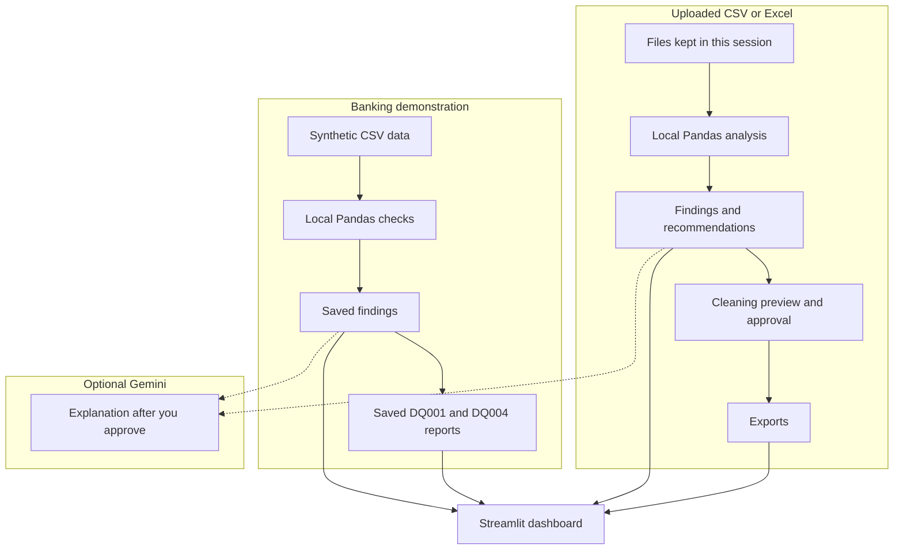

# Proactive AI Data Quality Agent

A portfolio project for a data analyst who has to defend engagement and pipeline numbers. It measures data-quality problems with deterministic checks, separates those measurements from later hypotheses, and lets you profile your own CSV or Excel files without applying the banking rules to them.

All customers, campaigns, interactions, and opportunities are synthetic. They describe a fictional commercial bank created for this project. They are not real customer data.

## See it in two minutes

From the project root, after the setup below:

```powershell
.\.venv\Scripts\python.exe -m streamlit run src/dashboard/app.py
```

The walkthrough is in [docs/demo_walkthrough.md](docs/demo_walkthrough.md). The sidebar shows **Overview** and **Analyze a file**. Findings, Investigation, and the paused SQL studio stay in the code and are not sidebar destinations.

## What a reviewer can see

**Banking demonstration.** Seven saved checks on the synthetic warehouse. Overview shows those measurements, the stored severity, and the charts. There is no combined quality score.

**My uploaded files.** CSV and Excel, including more than one file and more than one worksheet. The app profiles missing values, exact duplicates, mixed types, and outliers; suggests candidate keys and cross-dataset relationships; and writes offline recommendations. You choose required columns and unique keys. Cleaning is preview, approve, undo, and reset. The original upload stays intact. Reports, cleaned files, and the cleaning audit download separately.

Switching pages does not drop the upload. A successful upload selects **My uploaded files**. You can switch back to **Banking demonstration** at any time.

## Synthetic banking case study

The analytics question is whether customer, campaign, and pipeline reporting can be trusted. The engine reads `data/corrupted/` and writes `outputs/dq_findings.json`. It does not read `injected_issues.json`, and it does not estimate revenue, cost, or financial loss.

Saved investigations exist for DQ001 and DQ004 in `outputs/ai_investigations/`. In those files, confirmed evidence repeats the check. The narrative, including any business-impact paragraph, is a hypothesis. The other five checks have no saved investigation. Those reports are not a sidebar page.

| Check | Saved measurement | Why it matters for analysis |
| --- | --- | --- |
| DQ001 Customer Uniqueness | 150 excess `customer_id` rows on 10,150 customer rows (10,000 distinct ids). Rate 1.48% versus a 0.10% fail line. High. | The customer master is the join key for interactions and opportunities. Duplicate ids inflate customer counts and any metric built from that master. |
| DQ002 Customer ID Completeness | 3,933 of 98,465 interactions have no `customer_id`. Rate 3.99% versus 1%. High. | Those events cannot be joined to a customer, so engagement and conversion counts that start from the customer are short. |
| DQ003 Customer Referential Integrity | 1,961 of 94,532 non-null interaction ids are absent from the customer master. Rate 2.07% versus 0.50%. Critical. | The id is present and still fails the join. Customer-level reports drop or mis-assign those events. |
| DQ004 Campaign Attribution Completeness | 6,736 of 39,401 campaign-driven interactions have no `campaign_id`. Rate 17.10% versus 8%. High. Eligible types are Email Open, Email Click, and Event Attendance. Organic and relationship-manager rows are outside this check. | Campaign response for those channels is incomplete. A null `campaign_id` on other interaction types is not, by itself, this failure. |
| DQ005 Industry Null-Rate Spike | Among customers updated in the 14 days ending 2026-09-30, 368 of 2,458 are missing `industry`. The older baseline is 0 of 7,692. The saved metric is that gap, 0.150, versus a fail line of 0.05. High. | Recent industry cuts are incomplete. The metric is the gap between two null rates, not a share of every customer and not a loss amount. |
| DQ006 Opportunity Freshness | Opportunity dates stop at 2026-09-23. Customers and interactions reach 2026-09-30. Lag 7 days versus 2 days. High. | Pipeline tables are a week behind the rest of this warehouse. The metric is a day count. The check does not use the computer's clock. |
| DQ007 Interaction Volume Anomaly | On 2026-09-27 the warehouse has 500 interactions against a trailing baseline of 2,027. Deviation −75.3% versus a fail line of −50%. The saved affected count, 1,527, is that shortfall. High. | A one-day volume break changes daily engagement charts. The deviation is not the share of all 98,465 interactions. |

Confirmed facts are the counts, rates, dates, and thresholds above. The project does not claim a root cause for any of them. A duplicate master row, a blank foreign key, a stale pipeline date, or a thin day of events can each have more than one operational explanation. Those explanations stay hypotheses until someone verifies them outside this check.

Column details are in [docs/data_dictionary.md](docs/data_dictionary.md).

## Architecture



The banking checks never run on an arbitrary upload. The upload profiler never reads the banking findings file. Optional model text is requested only after you approve the summary shown on the page.

## Setup

Python 3.12. From the project root:

```powershell
python -m venv .venv
.\.venv\Scripts\Activate.ps1
pip install -r requirements.txt
.\.venv\Scripts\python.exe -m pytest -q
.\.venv\Scripts\python.exe -m streamlit run src/dashboard/app.py
```

On macOS or Linux, activate with `source .venv/bin/activate`.

The repository already contains `data/clean/`, `data/corrupted/`, `outputs/dq_findings.json`, and the two saved investigation files. The case-study figures above are those saved results. Tests expect these files. Regenerating the synthetic data rewrites them and can change the figures:

```powershell
python src/generate_data.py
python src/inject_quality_issues.py
python src/dq_engine/engine.py
```

Leave regeneration out of the demo.

## Optional Gemini

The two-minute demo and the test suite do not call a model.

A model is optional in two places:

- The command `python -m src.ai_agents.run_investigation` writes a new banking investigation. `--dry-run` lists the findings and does not call a model.
- On an uploaded recommendation, **Explain with AI** stays off until an API key is configured and you approve the summary printed on the page.

Copy `.env.example` to `.env`. Set `DQ_INVESTIGATOR_MODEL` and the matching key. A model id that starts with `gemini/` uses `GEMINI_API_KEY` or `GOOGLE_API_KEY`. Do not commit a key. If no key is configured, offline recommendations and the saved banking reports still load.

The investigator and the upload explanation receive a summary of a finding. They do not receive uploaded cell values, and they do not read `injected_issues.json`. A narrative that adds an unsupported number or states a confirmed cause is discarded.

## Privacy and other limits

- Uploaded files stay in the browser session. They are not written into the project folder.
- Nothing from an upload is sent to a model unless you approve the summary on screen. That summary uses dataset and column references, counts, and issue types. It does not include the raw rows.
- Uploaded findings have no severity and no overall quality score. Candidate keys and relationships are suggestions, not confirmed foreign keys.
- Banking severity exists only because each saved check stores one. Those seven ratings are not reused on other files.
- Cleaning changes the working copy only after preview and approval. Undo and reset are separate from removing the file from the session.
- JSON and CSV quality downloads cover one dataset. The consolidated workbook, the recommendation workbook, cleaned files, and the audit workbook are separate downloads.
- After you leave the Upload step, the file picker can look empty while the session still holds the file. The inventory and **My uploaded files** still list it. Choosing the file again replaces the session.
- Findings, Investigation, and **AI SQL Studio** are not in the sidebar. Their code remains. The studio does not generate or run SQL.

## Where the code lives

| Path | Role |
| --- | --- |
| `src/dq_engine/` | Banking checks. Writes `outputs/dq_findings.json`. |
| `src/ai_agents/` | Loads findings and, when asked, investigates one finding. |
| `src/universal_dq/` | Schema-independent profile, relationships, cleaning, and recommendations. |
| `src/dashboard/` | Streamlit app: banking pages, upload workflow, and the paused studio page. |
| `config/data_config.yaml` | Generator settings and banking thresholds. |
| `docs/demo_walkthrough.md` | Spoken two-minute demo. |
